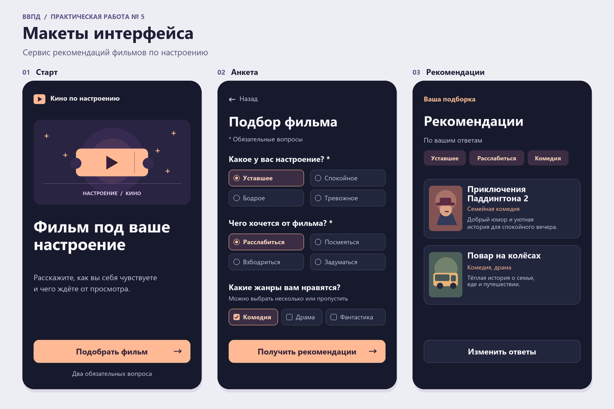
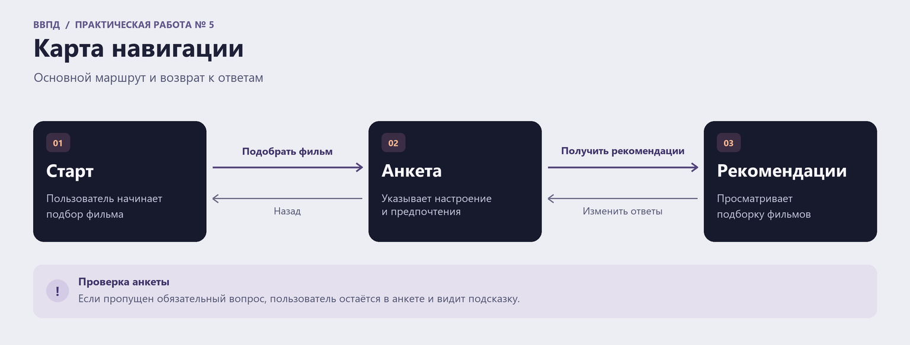

# Отчёт по практической работе № 5 «Разработка интерфейса»

- **Дисциплина** «Введение в профессиональную деятельность»
- **Проект** «Сервис рекомендаций фильмов по настроению»
- **Команда** «Прокрастинация»
- **Участники команды** Мартыненко А. Р., Морозов И. А., Морозова Е. Ю., Москвитин С. А., Никитин С. А.
- **Преподаватель** доц. Крошилина С. В.

## 1. Назначение и элементы экранов

В [работе № 4](../practical-work-04/report.md) команда выбрала анкету перед выдачей рекомендаций. Пользователь сообщает, какое у него сейчас настроение и чего он ждёт от просмотра. При желании он уточняет жанры. По этим ответам сервис предлагает подборку фильмов.

| Экран | Назначение | Элементы и их действия |
| --- | --- | --- |
| **Старт** | Объяснить, что предлагает сервис, и начать подбор. | Заголовок и короткое описание объясняют сценарий. Кнопка «Подобрать фильм» открывает анкету. |
| **Анкета** | Узнать текущее настроение, желаемый эффект от просмотра и предпочтения по жанрам. | В первых двух вопросах можно выбрать по одному ответу. Жанры можно пропустить или выбрать несколько. «Назад» возвращает на старт. «Получить рекомендации» проверяет ответы на обязательные вопросы и открывает подборку. |
| **Рекомендации** | Показать подобранные фильмы и помочь пользователю выбрать один из них. | Над списком показаны ответы, по которым сделана подборка. В карточке есть название, жанр и короткое объяснение, почему фильм подходит. «Изменить ответы» возвращает в анкету с заполненными полями. |

## 2. Макеты основных экранов

На макетах показан пример сценария, в котором уставший пользователь хочет расслабиться и выбирает комедии. Фильмы на экране рекомендаций приведены для примера.

## 3. Карта навигации

При нажатии «Получить рекомендации» переход выполняется после ответа на оба обязательных вопроса. Если один из них пропущен, анкета остаётся открытой, под пропущенным вопросом появляется подсказка «Выберите один вариант», а введённые ответы сохраняются. После просмотра подборки пользователь может изменить ответы и получить новую.

## 4. Обоснование решений для целевой аудитории

В [работе № 3](../practical-work-03/report.md) выделены три группы пользователей. Для каждой в интерфейсе предусмотрено следующее.

| Группа | Потребность | Решение в интерфейсе |
| --- | --- | --- |
| Молодые люди, которые знакомятся с кино | Понять, с какого фильма начать. | На старте видно, как запустить подбор. В карточке простыми словами объясняется, почему фильм подходит под ответы. |
| Люди, которые выбирают фильм после работы | Быстро подобрать фильм для отдыха. | Для подбора достаточно двух ответов. Жанры можно пропустить, а причину рекомендации можно прочитать прямо в подборке. |
| Киноманы | Точнее передать запрос на конкретный просмотр. | Текущее настроение и желаемый эффект задаются отдельно. Можно выбрать несколько жанров и уточнить ответы после просмотра подборки. |

## 5. Вывод

Спроектированы три экрана сервиса и переходы между ними. Пользователь может начать подбор, указать настроение и предпочтения, посмотреть рекомендации и уточнить ответы. Макеты и карта навигации задают сценарий для прототипа в работе № 6.
